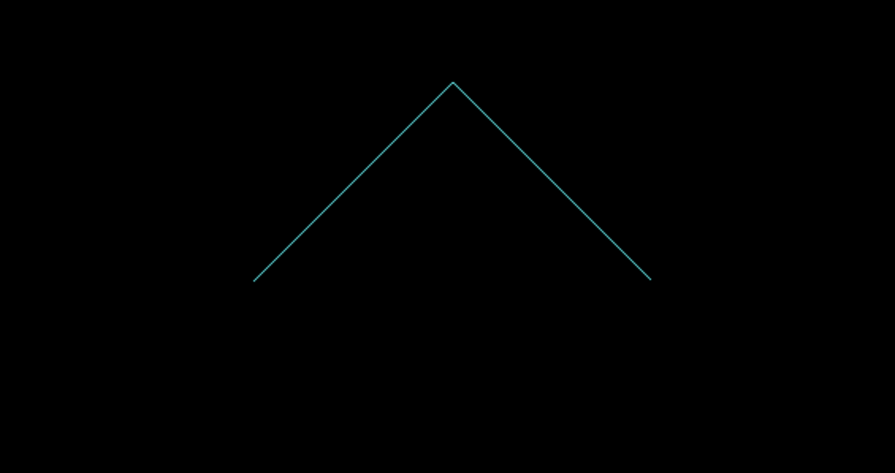

# three.js tutorial

Demos following the [three.js manual](https://threejs.org/manual/). Run `npx vite` and open a demo folder with a trailing slash, e.g. http://localhost:5173/1_creating_a_scene/.

## 1. Creating a scene

[1_creating_a_scene/](1_creating_a_scene/) · [manual](https://threejs.org/manual/#creating-a-scene)

## 2. Creating text

[2_creating_text/](2_creating_text/) · [manual](https://threejs.org/manual/#creating-text)

## 3. Drawing lines

[3_drawing_lines/](3_drawing_lines/) · [manual](https://threejs.org/manual/#drawing-lines)

## 4. Loading 3D models

[4_loading_3d_models/](4_loading_3d_models/) · [manual](https://threejs.org/manual/#loading-3d-models)
