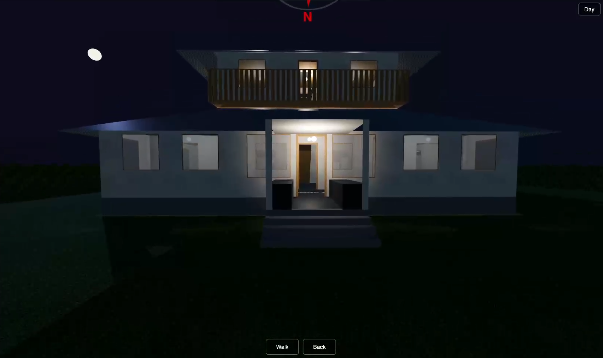
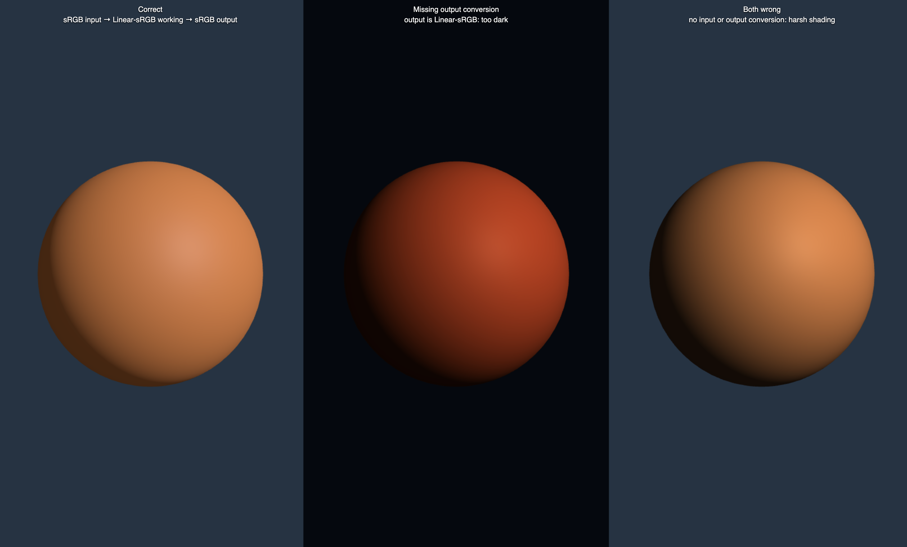
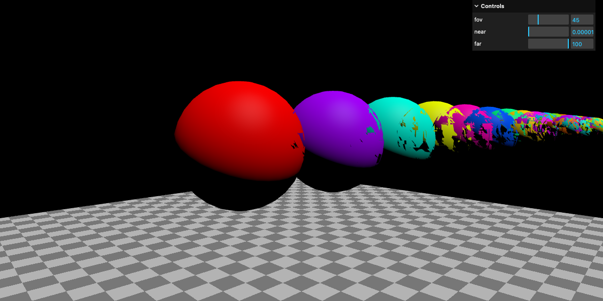
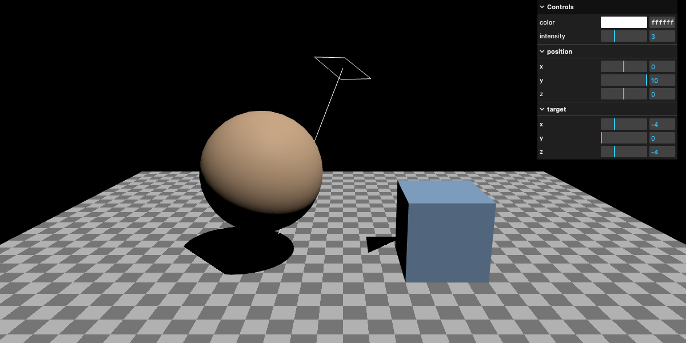

# three.js tutorial

My demos follow the [three.js manual](https://threejs.org/manual/). 

## Floor plans

[floor-plans/](floor-plans/) · [live demo](https://threejs-seven-wheat.vercel.app/floor-plans/) · [video demo](https://youtu.be/oI1bb07eZ9s)

## 1. Creating a scene

[1_creating_a_scene/](threejsmanual/1_creating_a_scene/) · [manual](https://threejs.org/manual/#creating-a-scene)

https://github.com/user-attachments/assets/d9445790-b92e-4003-ac6e-458a52fe4777

## 2. Creating text

[2_creating_text/](threejsmanual/2_creating_text/) · [manual](https://threejs.org/manual/#creating-text)

https://github.com/user-attachments/assets/cdf9270c-00b0-4b44-9798-c6807063df2b

## 3. Drawing lines

[3_drawing_lines/](threejsmanual/3_drawing_lines/) · [manual](https://threejs.org/manual/#drawing-lines)

## 4. Loading 3D models

[4_loading_3d_models/](threejsmanual/4_loading_3d_models/) · [manual](https://threejs.org/manual/#loading-3d-models)

https://github.com/user-attachments/assets/27997810-0b2a-4b92-8b2b-b187cb0d7f65

## 5. Animation system

[5_animation_system/](threejsmanual/5_animation_system/) · [manual](https://threejs.org/manual/#animation-system)

https://github.com/user-attachments/assets/81aed116-2414-41b6-b7dd-5459cd9c2a46

## 6. Color management

[6_color_management/](threejsmanual/6_color_management/) · [manual](https://threejs.org/manual/#color-management)

## 7. How to dispose of objects

[7_how_to_dispose_of_objects/](threejsmanual/7_how_to_dispose_of_objects/) · [manual](https://threejs.org/manual/#how-to-dispose-of-objects)

https://github.com/user-attachments/assets/48a60431-da81-4b7f-877d-34582cf1d1d3

## 8. How to update things

[8_how_to_update_things/](threejsmanual/8_how_to_update_things/) · [manual](https://threejs.org/manual/#how-to-update-things)

https://github.com/user-attachments/assets/cf4be4df-3f81-4f43-9bd4-11ed844fc96e

## 9. How to use post processing

[9_how_to_use_post_processing/](threejsmanual/9_how_to_use_post_processing/) · [manual](https://threejs.org/manual/#how-to-use-post-processing)

https://github.com/user-attachments/assets/65b3932d-0647-4f9e-8e46-36dac74360f2

## 14. Scenegraph — Tank

[14_scenegraph/7_tank/](threejsmanual/14_scenegraph/7_tank/) · [manual](https://threejs.org/manual/#scenegraph)

https://github.com/user-attachments/assets/6d667cde-311e-4da4-9574-c083d7dd23da

## 17. Lights — Point light

[17_lights/4_point_light/](threejsmanual/17_lights/4_point_light/) · [manual](https://threejs.org/manual/#lights)

https://github.com/user-attachments/assets/f51d5981-c7c7-46e5-b63b-dad456fe4327

## 18. Cameras — Perspective camera

[18_cameras/1_perspective_camera/](threejsmanual/18_cameras/1_perspective_camera/) · [manual](https://threejs.org/manual/#cameras)

https://github.com/user-attachments/assets/28f3b022-d0ab-406b-908b-0bf842bf226b

## 18. Cameras — Z fighting

[18_cameras/2_z_fighting/](threejsmanual/18_cameras/2_z_fighting/) · [manual](https://threejs.org/manual/#cameras)

## 18. Cameras — Orthographic camera

[18_cameras/3_orthographic_camera/](threejsmanual/18_cameras/3_orthographic_camera/) · [manual](https://threejs.org/manual/#cameras)

https://github.com/user-attachments/assets/dc8d8b9f-77bd-4178-919a-bcaa41123dbd

## 19. Shadows — Fake shadow

[19_shadows/1_fake_shadow/](threejsmanual/19_shadows/1_fake_shadow/) · [manual](https://threejs.org/manual/#shadows)

https://github.com/user-attachments/assets/bfb1f2ec-03d3-4f8c-8c67-bd312b0145b2

## 19. Shadows — Missing shadow

[19_shadows/2_missing_shadow/](threejsmanual/19_shadows/2_missing_shadow/) · [manual](https://threejs.org/manual/#shadows)

## 19. Shadows — Point light shadow in box

[19_shadows/3_point_light_shadow_in_box/](threejsmanual/19_shadows/3_point_light_shadow_in_box/) · [manual](https://threejs.org/manual/#shadows)

<!-- drop 3_point_light_shadow_in_box.mp4 here -->
